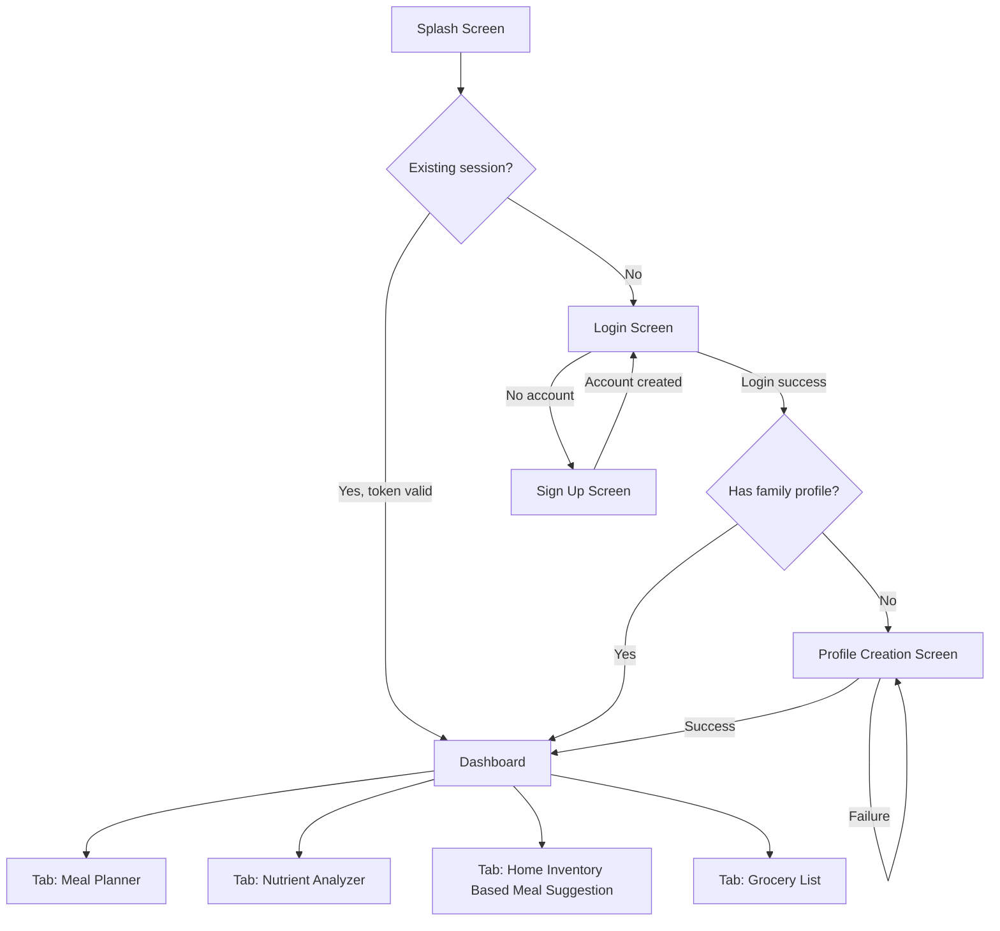
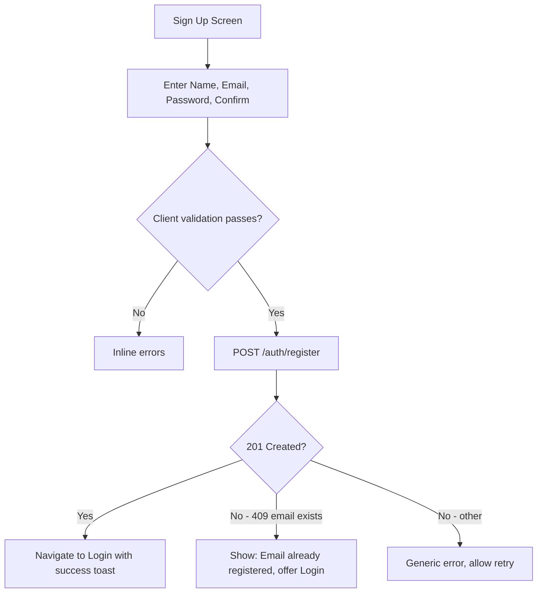
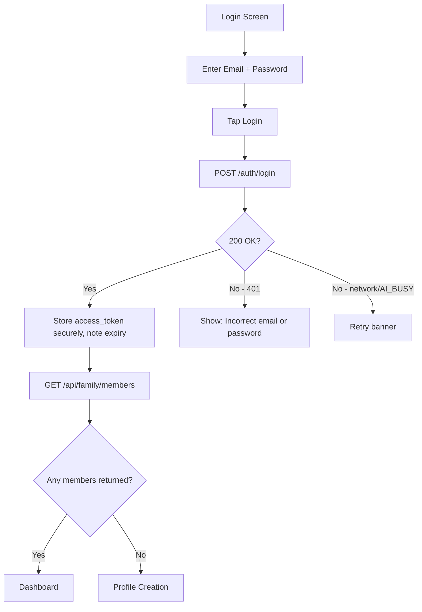
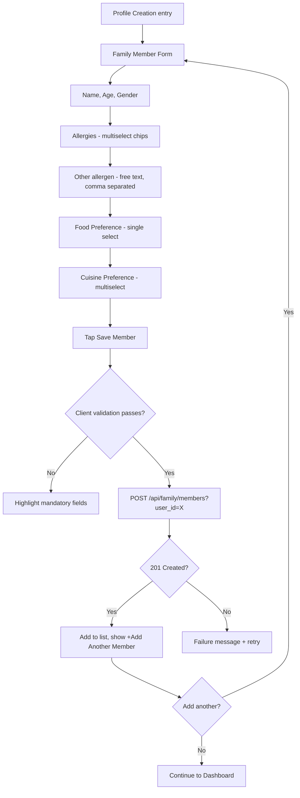
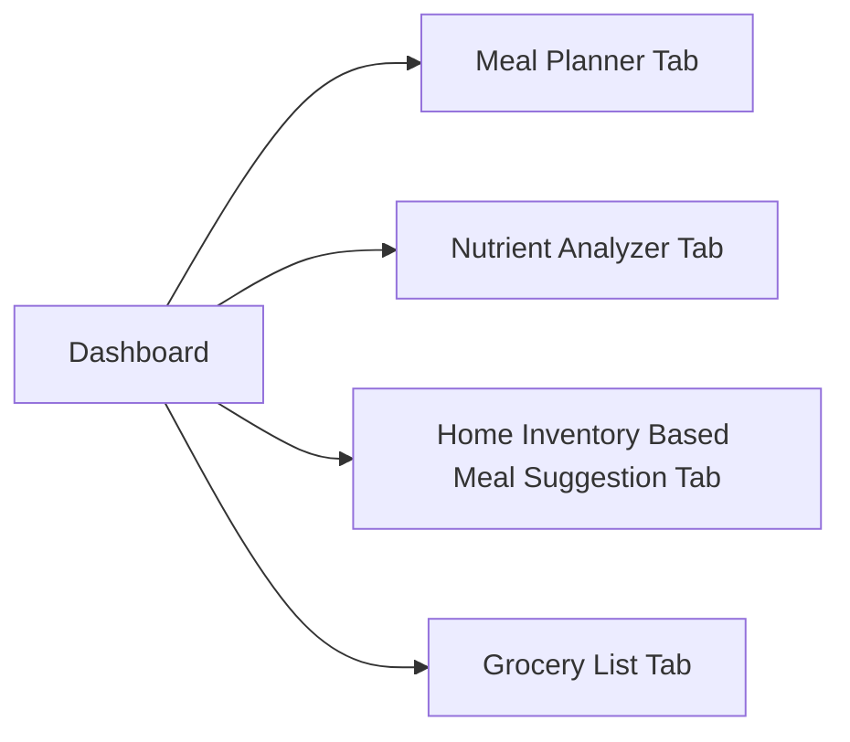
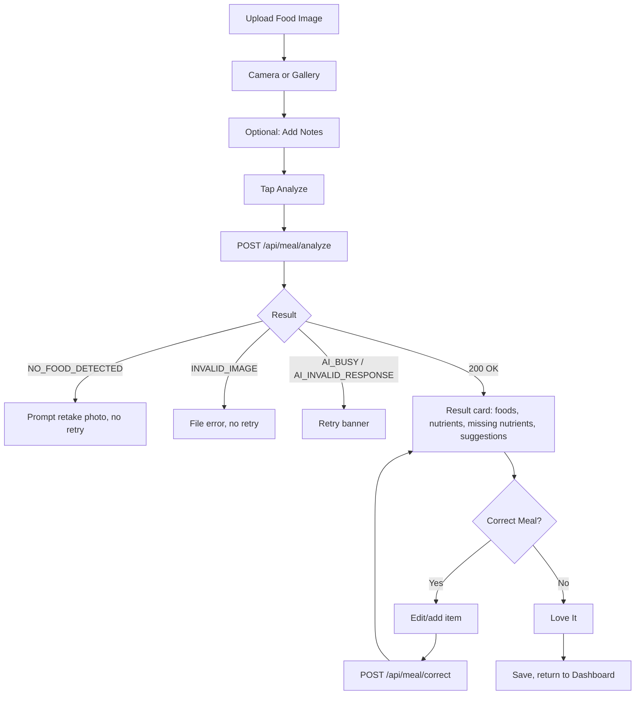
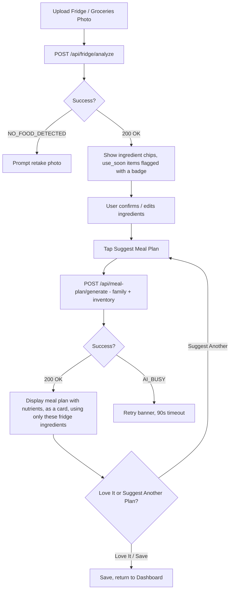
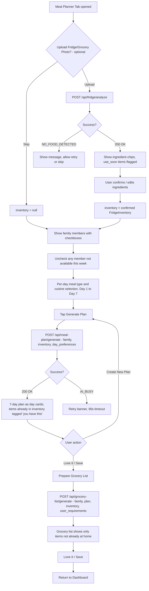
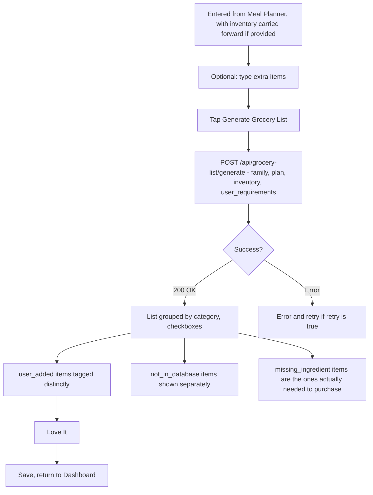

# NutriWise AI — Frontend Flow & Business Logic Reference

**Owner:** Frontend (Flutter)
**Status:** v1.4 — Meal Planner Tab now has an optional fridge/grocery photo step feeding into the full 7-day plan and grocery list
**Purpose:** Single source of truth for every screen, its flow, its validations, and how it maps to the real backend/AI endpoints. Read this before building any screen.

> **Legend used throughout this doc**
> ✅ Confirmed — matches an existing backend/AI contract endpoint exactly
> ⚠️ Needs confirmation — endpoint exists but a detail is unconfirmed
> 🚧 Gap — no backend/AI endpoint exists yet, or a schema mismatch needs resolving
> ❌ Cut from MVP — decided, do not build

---

## 1. App Identity

| Item | Value |
|---|---|
| App name | **NutriWise AI** |
| Tagline | "Knows what's on your plate — what's handy and what's not" |
| Sub-tagline | "Eat Healthy. Waste Less." |
| Alt tagline (Dashboard) | "Stay Healthy, Feel Light" |
| Theme | Food + family + health. Warm, rounded, photo-forward. Age-inclusive (children → grandparents use this app). |

---

## 2. Full Screen Inventory

| # | Screen | Route | File | Maps to | Status |
|---|---|---|---|---|---|
| 1 | Splash | `/` | `splash_screen.dart` | — | ✅ |
| 2 | Login | `/login` | `login_screen.dart` | `POST /auth/login` — new, being built by backend | ⚠️ proposed contract in §4.2 |
| 3 | Sign Up | `/signup` | `signup_screen.dart` | `POST /auth/register` | ✅ |
| 4 | Profile Creation | `/profile` | `family_profile_screen.dart` | `POST /api/family/members` | ✅ |
| 5 | Dashboard (4 tabs) | `/dashboard` | `dashboard_screen.dart` | — | ✅ |
| 6 | Nutrient Analyzer | `/meal` | `meal_analysis_screen.dart` | `POST /api/meal/analyze`, `POST /api/meal/correct` | ✅ |
| 7 | Meal Planner Tab | `/plan` | `meal_plan_screen.dart` | Optional `POST /api/fridge/analyze` → `POST /api/meal-plan/generate` → `POST /api/grocery-list/generate` | ✅ flow updated, see §9 — 🚧 `day_preferences` payload needs confirmation |
| 8 | Home Inventory Based Meal Suggestion | `/fridge` | `fridge_analysis_screen.dart` | `POST /api/fridge/analyze` → `POST /api/meal-plan/generate` (fridge-only suggestion) | ✅ flow in §8 — see note below on overlap with §9 |
| 9 | Grocery List | `/grocery` | `grocery_list_screen.dart` | `POST /api/grocery-list/generate` | ✅ |
| ~~10~~ | ~~Grocery Purchase Based Weekly Planner~~ | — | — | — | ❌ **Cut from MVP** |

> ⚠️ **UX overlap to confirm with the team:** both §7 and §8 now let the user upload a fridge/grocery photo. They produce different results — §8 gives one quick suggestion built only from what's in the fridge; §9 (the Meal Planner) gives a full customizable 7-day plan across all family members and per-day meal types, which can *optionally* also account for what's already at home. This is intentional (quick suggestion vs. full planning), but confirm the tab labels/descriptions make this distinction clear on the Dashboard so users aren't confused about which one to use.

---

## 3. Global App Flow



---

## 4. Authentication Flow

### 4.1 Sign Up — ✅ confirmed



**Validation:** Name 2–50 chars · Email valid format · Password min 8 chars, 1 letter, 1 number · Confirm must match.

### 4.2 Login — proposed contract, endpoint being built by backend

**Proposed request**
```json
POST /auth/login
{ "email": "venkat@example.com", "password": "SecurePassword123" }
```

**Proposed response (200 OK)**
```json
{
  "access_token": "eyJ...",
  "token_type": "bearer",
  "expires_in": 3600,
  "user": { "id": 1, "name": "Venkat", "email": "venkat@example.com" }
}
```

**Proposed error (401)**
```json
{ "error": { "code": "INVALID_CREDENTIALS", "message": "Incorrect email or password", "retry": false } }
```



> ⚠️ Send this proposed contract to backend today; build against it now with `MockApi`, adjust only if the real implementation differs.

### 4.3 Security for auth

- Token stored via `flutter_secure_storage`, never `SharedPreferences`.
- `Authorization: Bearer <token>` attached via one Dio interceptor.
- Global 401 interceptor clears token, routes to `/login`.
- HTTPS only in release builds.
- Never store or log the password after submission.

---

## 5. Profile Creation (Family Profile Screen)



**Confirmed endpoints**

| Action | Endpoint | Returns |
|---|---|---|
| Create member | `POST /api/family/members?user_id={userId}` | `201 Created` |
| List members | `GET /api/family/members?user_id={userId}` | `200 OK`, `List<FamilyMember>` |
| Update member | `PUT /api/family/members/{memberId}` | `200 OK` |
| Delete member | `DELETE /api/family/members/{memberId}` | `204 No Content` |

**Validation rules**

| Field | Rule |
|---|---|
| Name | Required, 2–50 chars |
| Age | Required, integer 0–120 |
| Gender | Required, single select |
| Allergies | Multi-select chips from fixed vocabulary (§12). Optional. |
| Other allergen (free text) | Optional. Comma-separated. Hint: *"e.g. sesame, mustard"*. Split, trim, lowercase, merge into `allergies`. |
| Health condition | **Removed from this form for MVP.** Keep `healthConditions: []` in the model. |
| Food preference | Single select — vegetarian / non_vegetarian / eggetarian / vegan. Household-level default, separate from the per-day meal type in §9. |
| Cuisine preference | Multi-select chips. Empty = any cuisine. |

At least one family member is mandatory before "Continue to Dashboard" is enabled.

---

## 6. Dashboard — 4 Tabs



Use a `BottomNavigationBar` for thumb-reachability across ages. See the UX overlap note in §2 regarding tabs 1 and 3.

---

## 7. Nutrient Analyzer



Disclaimer banner required on the result card. 90-second Dio timeout.

---

## 8. Home Inventory Based Meal Suggestion — standalone quick-suggestion screen

This screen stays exactly as previously confirmed — a fast, single fridge-only suggestion, separate from the full planning flow in §9.



No navigation link to or from §9 — completely independent screen and state.

---

## 9. Meal Planner Tab — updated: optional photo step feeds the full 7-day plan and grocery list

**Change in v1.4:** the Meal Planner Tab now opens with an **optional** fridge/grocery photo upload. If the user uploads a photo, the confirmed inventory carries through the *entire* flow — into the 7-day plan generation **and** into the grocery list generation at the end, so the final grocery list only lists items the family doesn't already have. If the user skips the photo, the flow behaves exactly as before (`inventory: null` throughout).



### Step-by-step

1. **Optional photo step:** "Upload Fridge/Grocery Photo (optional)" button at the top of the screen, clearly marked optional so it doesn't block users who just want a quick plan. If uploaded, run the same `analyze_fridge` → confirm/edit ingredient chips flow as §8 (including the use-soon badge), then carry the confirmed `FridgeInventory` forward. If skipped, `inventory` stays `null` for the rest of this flow.
2. **Family member selection:** checklist from `GET /api/family/members`, default all checked. Unchecking excludes a member from the `family` array sent to the API.
3. **Per-day meal type + cuisine selection:** one of the 11 meal types (§12) per day, plus optional cuisine. "Use same for all days" shortcut applies Day 1's choice to every day.
4. **Generate plan:** call `generate_meal_plan` with whatever `inventory` was set in step 1 (`null` or confirmed). 90-second timeout.
5. **Result:** day cards (Mon–Sun) with meals + nutrients. If inventory was provided, compare each day's `ingredients` list against the inventory items client-side and tag overlapping ones with a small "✓ you have this" badge — a nice touch that reinforces the waste-reduction story, no backend change needed for this tagging.
6. **Regenerate / Create New Plan:** re-calls step 4 with the same selections.
7. **Love It / Save → Prepare Grocery List:** navigate into grocery list generation, **passing the same `inventory` object forward** (don't discard it after plan generation). This is what makes the grocery list naturally exclude items already on hand — no new backend logic needed, since `generate_grocery_list(family, plan, inventory, user_requirements)` already accepts inventory in the existing contract and marks matched items by `source`.

### 9.1 Finalized meal-plan request payload

```json
POST /api/meal-plan/generate
{
  "family": [ ...FamilyMember objects, filtered by availability... ],
  "inventory": { ... } or null,
  "day_preferences": {
    "Monday":    { "meal_type": "VLML", "cuisine_preferences": ["indian"] },
    "Tuesday":   { "meal_type": "HNML", "cuisine_preferences": ["chinese"] },
    "Wednesday": { "meal_type": "VJML", "cuisine_preferences": [] },
    "Thursday":  { "meal_type": "VGML", "cuisine_preferences": ["continental"] },
    "Friday":    { "meal_type": "SFML", "cuisine_preferences": ["italian"] },
    "Saturday":  { "meal_type": "HNML", "cuisine_preferences": [] },
    "Sunday":    { "meal_type": "VLML", "cuisine_preferences": ["indian"] }
  }
}
```

> 🚧 **Confirm with AI/backend teammates before pointing this at the real API:**
> 1. Does `generate_meal_plan` accept a new `day_preferences` parameter in this shape, or a different field name?
> 2. Can the AI prompt correctly honor religious/dietary rules per code (Jain = no root vegetables, Kosher, Halal)?
>
> Build and test the full flow now against `MockApi`. Only flip `useMock = false` for this screen once both are confirmed.

### 9.2 Grocery list follow-through — no new endpoint needed

The existing contract already supports "only what's missing": `generate_grocery_list(family, plan, inventory, user_requirements)` takes the same `FridgeInventory` type used everywhere else, and the AI contract states grocery items are tagged by `source` (`missing_ingredient`, `preference`, `user_added`). **The only frontend responsibility is to keep the confirmed inventory object in state from step 1 through to this call** — don't let it get dropped when the screen transitions from plan view to grocery list view.

---

## 10. Grocery List



---

## 11. Grocery Purchase Based Weekly Planner — Cut from MVP (confirmed)

Decided out of scope. No screen, no route, no model needed. Revisit post-hackathon if time allows.

---

## 12. Master Vocabulary & Validation Tables

### Allergies — multi-select
```
ALLERGIES = ["milk", "peanut", "egg", "tree_nuts", "soy", "wheat", "shellfish", "fish"]
```
Plus free-text **"Other allergen(s)"**, comma-separated, hint *"e.g. sesame, mustard"* — parsed client-side and merged into `allergies`.

### Health Conditions
**Removed from the Profile form for MVP.** Field stays in the model as `healthConditions: []`.

### Food Preferences — single select (Profile screen only)
```
FOOD_PREFERENCES = ["vegetarian", "non_vegetarian", "eggetarian", "vegan"]
```
Household-level default. Separate from the per-day meal type below.

### Cuisine Preferences — multi-select
```
CUISINE_PREFERENCES = ["indian", "chinese", "italian", "continental"]
```
Used at the profile level and per day in the Meal Planner.

### Meal Type — per-day selector, Meal Planner Tab only (§9)

Not used on the Home Inventory Based Meal Suggestion screen (§8).

| Code | Label | Description |
|---|---|---|
| `MOML` | Muslim Meal | Prepared to Islamic Halal standards; all Halal-certified ingredients |
| `HNML` | Hindu Non-Vegetarian Meal | Indian-style, no beef or pork |
| `VJML` | Vegetarian Jain Meal | No root vegetables, strictly plant-based |
| `VLML` | Vegetarian Lacto-Ovo Meal | Vegetarian with eggs and dairy |
| `VGML` | Vegan Meal | Fully plant-based, no animal products |
| `KSML` | Kosher Meal | Prepared to Jewish dietary laws |
| `FPML` | Fruit Platter Meal | Fresh seasonal fruit only |
| `SFML` | Seafood Meal | Seafood-based dishes throughout |
| `AVML` | Asian Vegetarian Meal | Indian-style vegetarian |
| `RVML` | Raw Vegetarian Meal | Uncooked plant-based ingredients |
| `VOML` | Vegetarian Oriental Meal | Asian-style vegetarian |

UI shows the label and description; the code is sent as `meal_type`. Default: `VLML`.

### Image upload rules
JPEG/PNG/WebP, max 5 MB, client-compressed to `maxWidth: 1024, imageQuality: 80`.

---

## 13. Success / Failure Handling Pattern

| Backend `code` | UI behavior |
|---|---|
| `INVALID_IMAGE` | Dialog, no retry |
| `INVALID_INPUT` | Inline/banner error, no retry |
| `NO_FOOD_DETECTED` | Prompt retake, no retry |
| `AI_BUSY` | Retry banner, consider one auto-retry |
| `AI_INVALID_RESPONSE` | Retry banner |
| `INTERNAL` | Generic error, no retry |
| `INVALID_CREDENTIALS` (proposed, login) | "Incorrect email or password", no retry |
| Network/timeout | Generic connectivity message + retry |

Every result screen: **Love It / Save** action + `DisclaimerBanner` wherever nutrition content is shown.

---

## 14. Security Checklist

- [ ] Token via `flutter_secure_storage`
- [ ] HTTPS only in release builds
- [ ] Auth header via single Dio interceptor
- [ ] Global 401 interceptor → clear token → `/login`
- [ ] No PII in logs
- [ ] Images as raw multipart bytes, not base64
- [ ] Client-side image compression before upload
- [ ] No API keys anywhere in Flutter code

---

## 15. Design Direction

Warm greens + terracotta, rounded cards, food iconography, 16sp+ text, large icon+label buttons, short transitions, age-appropriate family member icons on the Profile screen. Meal-type picker (§9): bottom-sheet radio list with label + description, not inline chips. The optional photo upload button in §9 should read clearly as optional (e.g. "Upload Fridge Photo (optional)") so it doesn't feel like a blocking requirement.

---

## 16. Open Questions for the Team

1. ~~Login endpoint~~ — **resolved**: proposed contract in §4.2, awaiting backend build.
2. ~~Family member save endpoint~~ — **resolved**, see §5.
3. ~~Grocery bill planner scope~~ — **resolved**: cut from MVP.
4. ~~Vocabulary lists~~ — **resolved**, see §12.
5. ~~Use-soon flow~~ — **resolved**, see §8.
6. ~~Per-day preference structure~~ — **resolved**, see §9.1.
7. ~~Home Inventory Suggestion vs Meal Planner relationship~~ — **resolved**: both exist, §9's photo step is optional and feeds a full plan + grocery list; §8 remains a separate quick fridge-only suggestion. UX distinction flagged in §2 for team review.
8. **Open:** Does `generate_meal_plan` accept the `day_preferences` field as shaped in §9.1, and under what parameter name?
9. **Open:** Can the AI prompt reliably honor Jain/Kosher/Halal-specific rules per meal type?
10. **Open:** Where is a generated `WeeklyPlan` saved when the user taps "Love It" on either §8 or §9 — a dedicated save endpoint, or does generation persist automatically?
11. **Open:** How should free-text "other allergens" be matched during the backend's allergy-safety filter?

---

*Update this document whenever a screen's flow or a backend/AI contract field changes. Reference it in PR descriptions for any screen work.*
