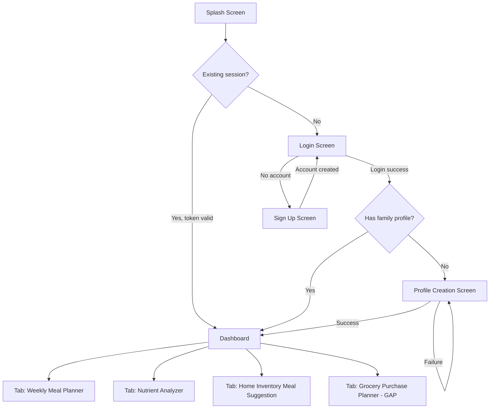
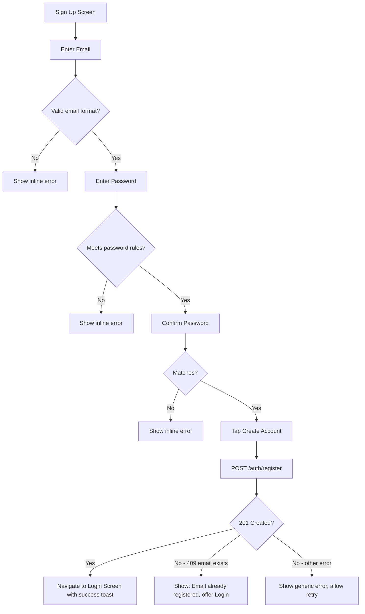
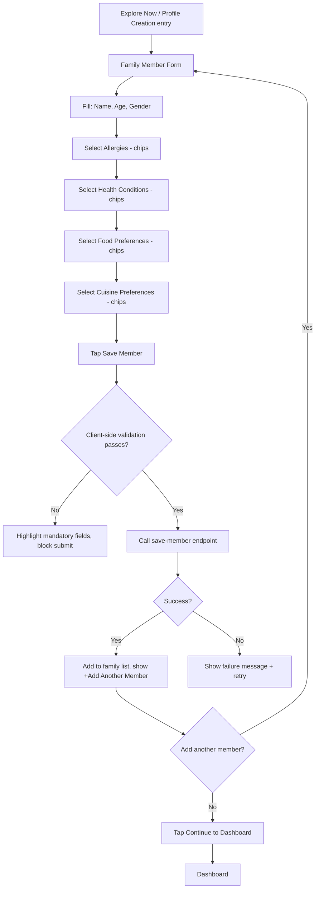
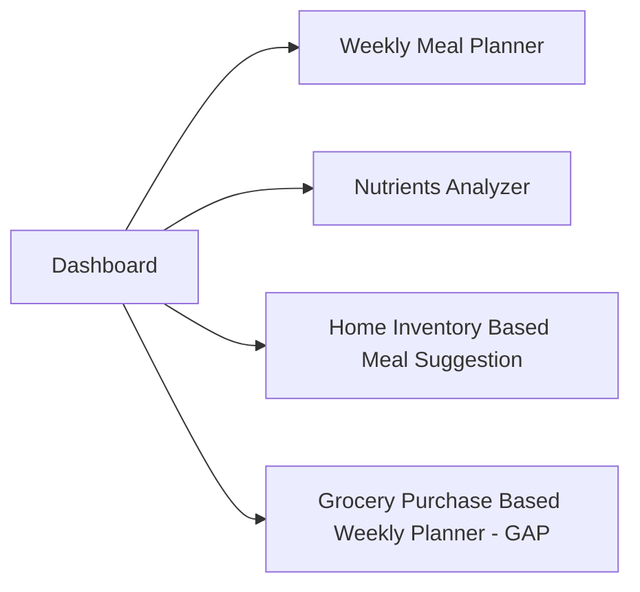
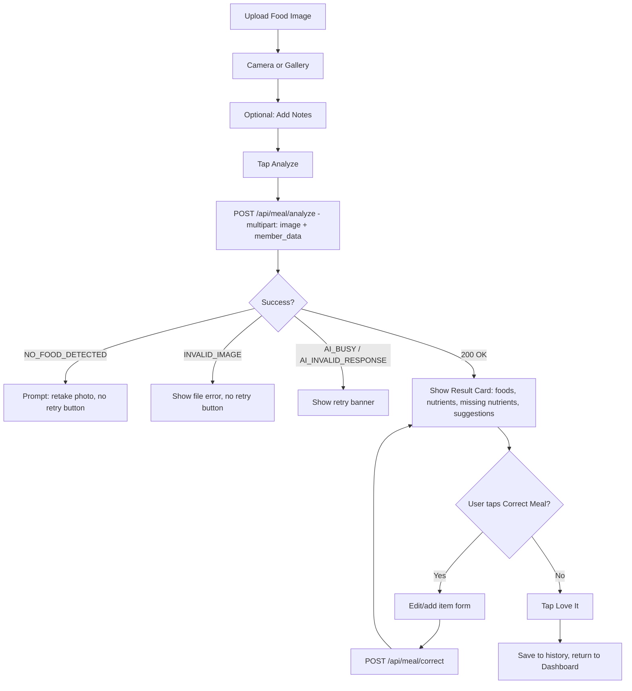
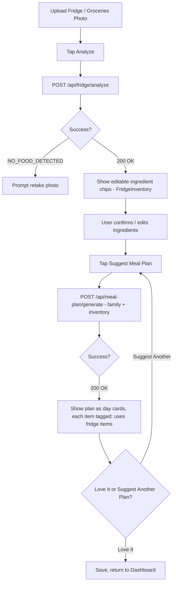
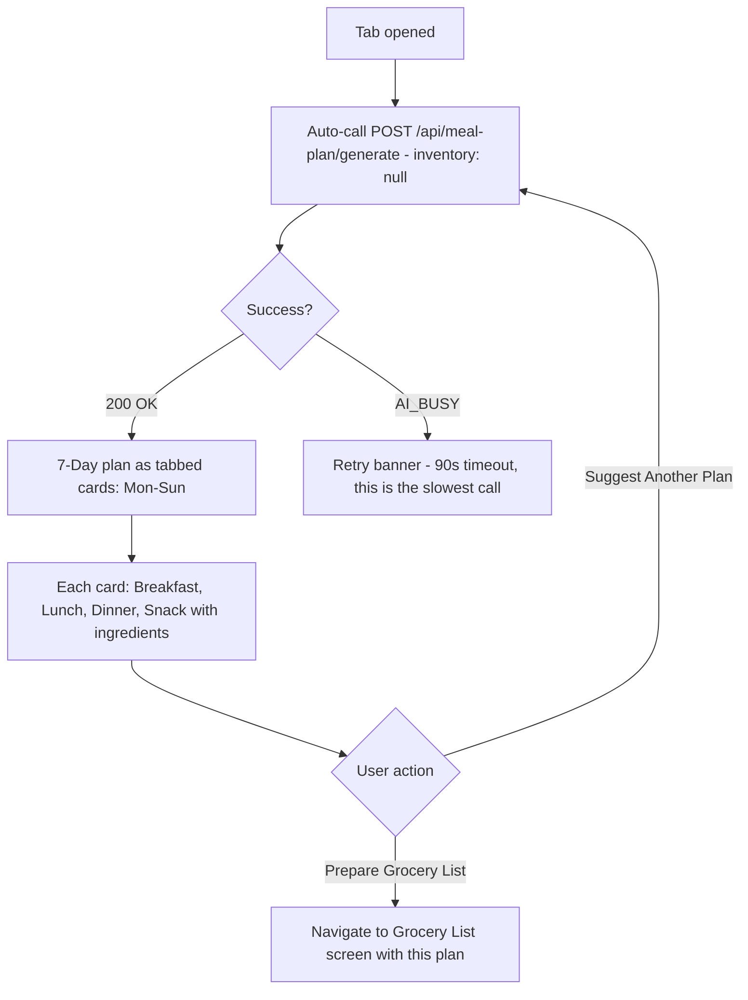
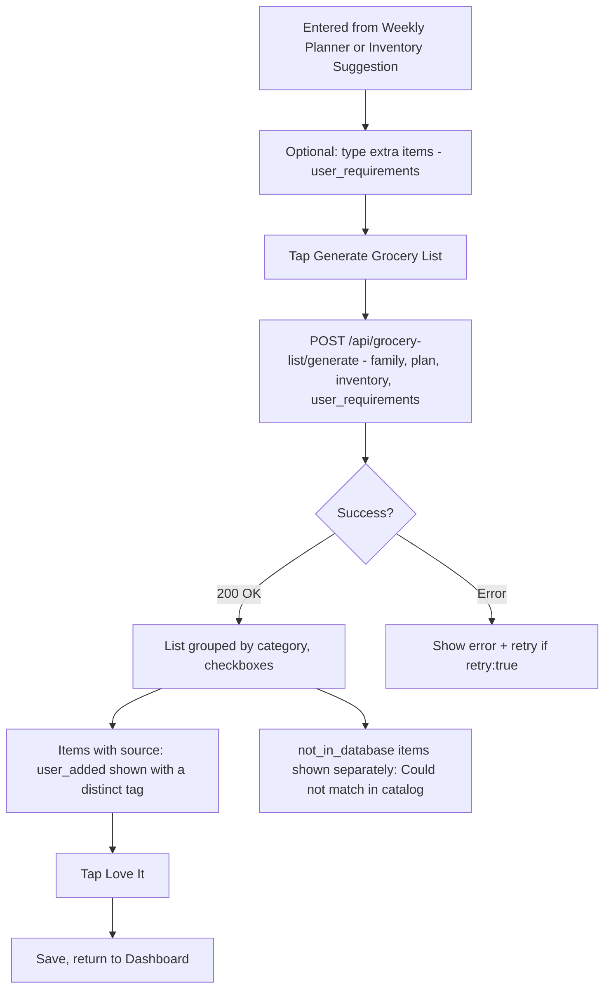

# NutriWise AI — Frontend Flow & Business Logic Reference

**Owner:** Frontend (Flutter)
**Status:** Draft v1.0 — based on hand-drawn wireframes, reconciled against `ai-services` contract and `backend` API contract
**Purpose:** Single source of truth for every screen, its flow, its validations, and how it maps to the real backend/AI endpoints. Read this before building any screen.

> **Legend used throughout this doc**
> ✅ Confirmed — matches an existing backend/AI contract endpoint exactly
> ⚠️ Needs confirmation — endpoint exists but a detail is unconfirmed
> 🚧 Gap — no backend/AI endpoint exists yet for this; do not build against it until resolved

---

## 1. App Identity

| Item | Value |
|---|---|
| App name | **NutriWise AI** |
| Tagline | "Knows what's on your plate — what's handy and what's not" |
| Sub-tagline | "Eat Healthy. Waste Less." |
| Alt tagline (Dashboard) | "Stay Healthy, Feel Light" |
| Theme | Food + family + health. Warm, rounded, photo-forward. Age-inclusive (children → grandparents use this app). |

---

## 2. Full Screen Inventory

This supersedes the original 7-screen list from the initial planning doc — the wireframes added auth screens and split "Fridge Analysis" into two distinct features.

| # | Screen (from sketches) | Route | File | Maps to | Status |
|---|---|---|---|---|---|
| 1 | Splash | `/` | `splash_screen.dart` | — | ✅ |
| 2 | Login | `/login` | `login_screen.dart` | `POST /auth/login` | ⚠️ not in backend doc yet — confirm with backend |
| 3 | Sign Up | `/signup` | `signup_screen.dart` | `POST /auth/register` | ✅ |
| 4 | Profile Creation | `/profile` | `family_profile_screen.dart` | ⚠️ no save-member endpoint documented yet | ⚠️ confirm with backend |
| 5 | Dashboard (4 tabs) | `/dashboard` | `dashboard_screen.dart` | — | ✅ (layout changed — see §6) |
| 6 | Nutrient Analyzer | `/meal` | `meal_analysis_screen.dart` | `POST /api/meal/analyze`, `POST /api/meal/correct` | ✅ |
| 7 | Home Inventory Based Meal Suggestion | `/fridge` | `fridge_analysis_screen.dart` | `POST /api/fridge/analyze` → `POST /api/meal-plan/generate` (with inventory) | ✅ (see §8 for exact mapping) |
| 8 | Weekly Meal Planner | `/plan` | `meal_plan_screen.dart` | `POST /api/meal-plan/generate` (no inventory) | ✅ |
| 9 | Grocery List | `/grocery` | `grocery_list_screen.dart` | `POST /api/grocery-list/generate` | ✅ |
| 10 | Grocery Purchase Based Weekly Planner | `/grocery-bill` | `grocery_bill_screen.dart` | **No matching AI/backend function** | 🚧 **GAP — see §11** |

**Action for you today:** raise items 2, 4, and 10 with your team in chat. Don't start building screens 2, 4 (its save call), or 10 until answered — everything else is safe to build now.

---

## 3. Global App Flow



---

## 4. Authentication Flow (Login / Sign Up)

### 4.1 Sign Up



**Validation rules (Sign Up)**

| Field | Rule | Error message |
|---|---|---|
| Name | Required, 2–50 chars | "Please enter your name" |
| Email | Required, RFC email regex | "Enter a valid email address" |
| Password | Min 8 chars, 1 letter, 1 number | "Password must be at least 8 characters with a letter and a number" |
| Confirm password | Must equal password | "Passwords don't match" |

Disable the **Create Account** button until the form is valid (`Form` + `GlobalKey<FormState>`, validate on every change, not only on submit).

### 4.2 Login

```mermaid
flowchart TD
    A[Login Screen] --> B[Enter Email + Password]
    B --> C[Tap Login]
    C --> D[POST /auth/login]
    D --> E{200 OK?}
    E -->|Yes| F[Store token securely]
    F --> G{Has family profile?}
    G -->|Yes| H[Dashboard]
    G -->|No| I[Profile Creation]
    E -->|No - 401| J[Show: Incorrect email or password]
    E -->|No - AI_BUSY/network| K[Show retry banner]
```



**"Forgot Password" and "Sign Up" links** sit below the Login button per your sketch — both are secondary `TextButton`s, not primary buttons, so they don't compete visually with Login.

> ⚠️ **Confirm with backend:** `/auth/login` response shape (does it return a JWT? refresh token? expiry?) before building the token-storage logic in §4.3.

### 4.3 Security for auth (build this once, in `services/`)

- **Never store the password anywhere** after submission — not in state, not in logs.
- Store the returned auth token using **`flutter_secure_storage`**, not `SharedPreferences` (SharedPreferences is unencrypted).
- Attach the token as an `Authorization: Bearer <token>` header on every authenticated Dio request via a Dio interceptor, so you don't repeat this per-call.
- On a `401` response from any endpoint (token expired), clear the stored token and route back to `/login` automatically — build this as a global Dio interceptor, not per-screen logic.
- All API calls go over **HTTPS only** — never allow `http://` in the production `baseUrl`. Keep a separate debug-only `http://10.0.2.2:8000` for the Android emulator during local testing, but ensure it can't ship in a release build (guard with `kReleaseMode`).
- Add `flutter pub add flutter_secure_storage` now.

---

## 5. Profile Creation (Family Profile Screen)



**Validation rules (Family Member form)**

| Field | Rule |
|---|---|
| Name | Required, 2–50 chars |
| Age | Required, integer 0–120 |
| Gender | Required, single select |
| Allergies | Optional, multi-select from shared vocabulary list (see §12) |
| Health conditions | Optional, multi-select |
| Food preferences | Optional, multi-select |
| Cuisine preferences | Optional, multi-select — empty means "any cuisine" per AI contract, so don't force a minimum selection |

At least **one family member** is mandatory before "Continue to Dashboard" is enabled — this matches your sketch's "Check validations, mandatory fields" note and the AI contract's requirement that `family: list[FamilyMember]` is never empty on plan/grocery calls.

> ⚠️ **Confirm with backend today:** which endpoint actually persists a `FamilyMember`. The contract shows `POST /auth/register` for the *user account* only — there's no documented endpoint for saving a family member. This blocks real (non-mock) implementation of this screen.

---

## 6. Dashboard — 4 Tabs

Per your sketch, the dashboard is reorganized into four tabs rather than four static cards:



Build this with a `TabBar`/`TabBarView` (or `BottomNavigationBar` — recommended for older users, since bottom tabs are more thumb-reachable and higher-contrast than a scrollable top tab bar). Each tab's content is effectively an entry point into the corresponding full-screen flow (§7–§11), either embedded or pushed as a new route — **push as a new route** for now, it's simpler to build and test independently per screen.

---

## 7. Nutrient Analyzer (Meal Analysis)



**Result card must show, per your sketch:**
- Detected foods + quantities
- Nutrients present (green chips)
- Missing nutrients (orange chips) — this drives the "suggest what to add in future" note from Image 4
- Suggestions (plain text list)
- `DisclaimerBanner`: "AI-generated suggestions, not medical advice."

**Correct Meal sub-flow** — matches the AI contract's `correct_meal` exactly:
- Tap any detected item → inline edit (name, weight) → sends `{item_index, name, weight_g}`
- "+ Add missed item" → sends `{item_index: null, name, weight_g}`
- Show `needs_review: true` items with a small warning icon — this is the API telling you the dish wasn't matched in the nutrition database
- After correction, **re-render the full card** with the new `MealAnalysis` returned (it's a complete recalculation, not a patch)

**Timeouts:** meal analysis is a vision call — use a 90-second Dio timeout per the backend contract, and show the `LoadingView` with a rotating message so a 20-30 second wait doesn't feel broken.

---

## 8. Home Inventory Based Meal Suggestion

This is the one that maps cleverly onto the existing contract — no new backend work needed.



**Key detail your sketch called for** — "message their ingredients need to be used based on its life" (i.e., expiry/use-soon flagging): this comes from `InventoryItem.use_soon: bool` in the `FridgeInventory` response. Show a small "⏰ use soon" badge on those ingredient chips before the user confirms them, and visually prioritize `use_soon: true` items in the resulting plan if the AI surfaces them (check `DayPlan.notes` for this — confirm with AI teammate whether use-soon prioritization is reflected there).

This screen is functionally: **"Weekly Meal Planner, but with `inventory` populated instead of `null`."** Consider sharing the day-card widget between this screen and §9 rather than building it twice.

---

## 9. Weekly Meal Planner



Matches your sketch exactly: Day cards → Breakfast/Lunch/Dinner breakdown → "Prepare Grocery List" and "Suggest Another Plan" buttons. Note: **90-second timeout required** per backend contract — this is explicitly called out as the slowest endpoint.

---

## 10. Grocery List



Add a small text field / chip-input above the Generate button for `user_requirements` (e.g. "Anything else to add? Almond milk"), per the contract's optional field. Checked/unchecked state stays **local only** (not sent back to the server).

---

## 11. 🚧 Grocery Purchase Based Weekly Planner — GAP, do not build yet

Your sketch (Image 5, bottom) shows: **Upload Grocery Purchase Bill → Analyze → Suggest 7-day weekly plan.**

This requires turning a **receipt/bill photo** into a structured ingredient list — parsing item names and quantities from a purchase receipt. This is a fundamentally different vision task from `analyze_fridge` (photo of items in a fridge) and is **not covered by any of the 6 documented AI functions**.

**Options to raise with your team today:**
1. **Cut it from the MVP.** It wasn't in the original scope doc either (`Budget Optimization` was explicitly excluded, and this is adjacent). Given the Oct 8 deadline, this is the safest option — you already have Home Inventory Meal Suggestion covering a very similar "what do I have, what should I cook" use case.
2. **Ask the AI engineer for a 7th function**, e.g. `analyze_grocery_bill(image_bytes, mime_type) -> FridgeInventory`, reusing the same `FridgeInventory` output shape as `analyze_fridge` so no new frontend model is needed — only a new backend endpoint (`POST /api/grocery-bill/analyze`) and a new AI function. This is a small ask if the AI engineer has time, since it reuses existing schemas.
3. **Fake it for the demo only**: point the "Upload Bill" button at the existing `/api/fridge/analyze` endpoint (Gemini Vision may handle a receipt photo reasonably well even though it wasn't designed for it) — acceptable as a stretch-goal demo trick, **never** described as a real feature in your PPT if you do this.

**Recommendation:** build every other screen first. Revisit this only if you're ahead of schedule after Oct 3 (Integration Day). Don't block on it.

---

## 12. Master Validation Rules Table

| Field | Used on screens | Rule |
|---|---|---|
| Email | Login, Sign Up | RFC-valid format, required |
| Password | Login, Sign Up | Min 8 chars, 1 letter, 1 number |
| Name (user) | Sign Up | 2–50 chars, required |
| Name (family member) | Profile Creation | 2–50 chars, required |
| Age | Profile Creation | Integer, 0–120, required |
| Gender | Profile Creation | Required, single select |
| Allergies / Conditions / Food prefs / Cuisine prefs | Profile Creation | Optional multi-select, **must use a shared vocabulary list agreed with backend/AI** (exact lowercase strings, e.g. `"vegetarian"`, `"peanut"`, `"diabetes"`) — casing mismatches will silently break allergy-safety filtering server-side |
| Image upload (all analyzer screens) | Meal/Fridge/Bill analysis | JPEG/PNG/WebP, max 5 MB, client-compressed to `maxWidth: 1024, imageQuality: 80` before upload |
| Notes / user_requirements | Meal Analysis, Grocery List | Optional free text, max ~200 chars, plain text only |

**Get the exact allergy/condition/food-preference/cuisine string lists from your AI teammate before building the chip UIs** — this is the single most important shared-vocabulary item, since mismatched strings mean the allergy-safety filter (a hard safety requirement per the AI contract) won't recognize what the user selected.

---

## 13. Success / Failure Handling Pattern (applies to every screen)

Build **one shared error-handling pattern**, not one per screen, using the backend's documented error envelope:

```json
{ "error": { "code": "NO_FOOD_DETECTED", "message": "...", "retry": false } }
```

| Backend `code` | UI behavior |
|---|---|
| `INVALID_IMAGE` | Show `e.message` in a dialog. No retry button. Suggest re-picking an image. |
| `INVALID_INPUT` | Show `e.message` near the offending field if identifiable, else as a banner. No retry button. |
| `NO_FOOD_DETECTED` | Show `e.message`, prompt to retake/reselect photo. No retry button (retrying the *same* image won't help). |
| `AI_BUSY` | Show a retry banner with the message, **with** a retry button — consider auto-retry once after a short delay. |
| `AI_INVALID_RESPONSE` | Show retry button. |
| `INTERNAL` | Generic "Something went wrong" message, no retry button, offer to go back. |
| Network/timeout (no server response) | Generic connectivity message + retry button. |

Every result screen ends with:
1. A **"Love It" / Save** action, and
2. The `DisclaimerBanner` ("AI-generated suggestions, not medical advice") wherever nutrition or health content is shown.

---

## 14. Security Checklist (frontend responsibilities)

- [ ] Auth token stored via `flutter_secure_storage`, never `SharedPreferences`
- [ ] All API calls over HTTPS in release builds; debug-only HTTP guarded by `kReleaseMode`
- [ ] `Authorization: Bearer <token>` attached via a single Dio interceptor, not per-call
- [ ] Global 401 interceptor clears token and routes to `/login`
- [ ] No PII (email, password, health conditions) ever written to `print()`/logs in release builds
- [ ] Images sent as raw multipart bytes, never base64-encoded (per backend contract)
- [ ] Client-side image compression before upload (max 1024px width, 80% quality) — reduces both upload time and exposure of unnecessarily large personal photos
- [ ] Gemini API key and Supabase service keys are **never** referenced anywhere in Flutter code — they live only on the backend
- [ ] Family health data (allergies, conditions) only sent to your own backend, never to any third-party analytics SDK if one is added later

---

## 15. Design Direction — Age-Inclusive, Food/Family Theme

Building on the accessibility-first theme already in `lib/core/theme.dart`:

- **Color palette:** warm greens (health/freshness) + a secondary warm orange/terracotta (food warmth) — avoid clinical blue/white hospital tones.
- **Imagery:** rounded cards, soft shadows, food photography or simple flat food iconography (a plate, a fridge, a basket) rather than abstract icons — this reads instantly across ages and literacy levels.
- **Typography:** 16sp+ body text minimum (already set), generous line height, no all-caps labels (harder for older readers).
- **Family framing:** on the Profile Creation screen, consider a simple visual family-member list with age-appropriate icons (child/adult/senior silhouette) next to each name — makes the "who am I planning for" mental model instant, even for non-technical users.
- **Motion:** keep transitions short and simple (200–300ms) — avoid flashy animations that can disorient older users or feel unnecessary to children waiting to see food results.
- **Every primary action** (Analyze, Save, Love It, Generate) is a large, high-contrast, icon+label button — never icon-only, per the accessibility table from earlier planning.

---

## 16. Open Questions for the Team (send today)

1. Is there a documented `POST /auth/login` endpoint, and what's its response shape (token, expiry, refresh token)?
2. Which endpoint saves a `FamilyMember` to the database? Not shown in the current backend contract.
3. Is the "Grocery Purchase Based Weekly Planner" (bill upload) in scope for the MVP, or cut per §11? If in scope, who builds `analyze_grocery_bill`?
4. What is the exact shared vocabulary list (strings) for allergies, health conditions, food preferences, and cuisine preferences?
5. Does `DayPlan.notes` reflect use-soon/expiring ingredient prioritization, or is that only inferred client-side from the `FridgeInventory` passed in?

---

*This document should be updated whenever a screen's flow or a backend/AI contract field changes. Keep it in `docs/frontend-flow-and-business-logic.md` and reference it in PR descriptions for any screen work.*
